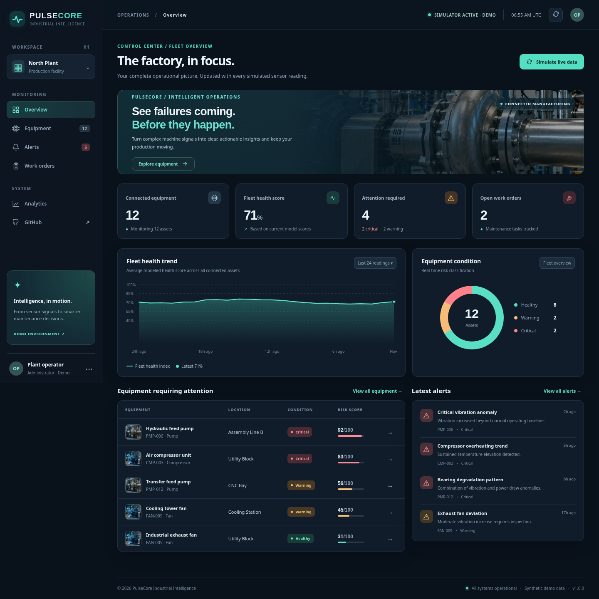
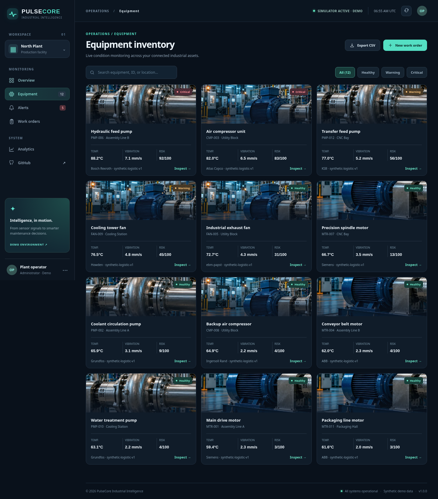
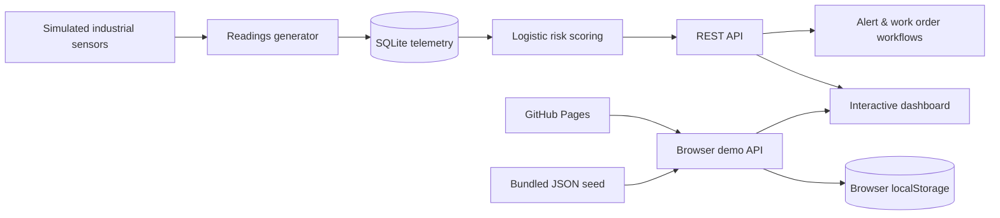

<div align="center">


# PULSECORE
### Industrial IoT · Predictive Maintenance · Equipment Intelligence

**A polished, interactive industrial monitoring dashboard built for the web.**


**Equipment health • Synthetic sensor streaming • Explainable risk scoring • Alerts • Work orders • Analytics**

</div>



> **Important:** This is a fully functional **portfolio/demo project** backed by simulated industrial measurements. The browser demo is designed to work on **GitHub Pages with no server**. The included optional Python backend uses actual SQLite persistence and provides a REST API. Its scoring formula is illustrative and **must not be used for real industrial safety or maintenance decisions**.

## ✨ Highlights

| Feature | What it does |
| --- | --- |
| **Fleet overview** | Shows connected assets, average modeled health, anomalies, maintenance tasks and trends. |
| **12 simulated machines** | Motors, pumps, compressors and fans across realistic plant locations. |
| **Five sensor channels** | Temperature (°C), vibration (mm/s), pressure (bar), current (A) and rotation speed (rpm). |
| **Risk model** | Explainable logistic score (0–100) with key contributing signals and health classifications. |
| **Simulator** | Generates fresh measurements for every machine and adds alerts when appropriate. |
| **Equipment drill-down** | View machine photo, specifications, 96-reading history chart and risk contributors. |
| **Alert management** | Review, filter and acknowledge anomaly alerts. |
| **Maintenance orders** | Create work orders and move them through Open → In progress → Completed. |
| **Analytics** | Risk rankings, fleet measurements and model-information disclosure. |
| **Export** | Download fleet telemetry as CSV from the equipment analytics UI. |
| **Responsive interface** | Dark industrial design, searchable asset cards, custom charts, reusable assets and mobile layouts. |

### Equipment management



---

## 🚀 Publish on GitHub Pages — **you do not need to run anything locally**

The repo already contains a working **static browser mode** and a GitHub Actions workflow that publishes `web/`.

1. Create a GitHub repository, e.g. `industrial-iot-predictive-maintenance`.
2. Upload **all the extracted project files**, preserving the folder structure (including `.github/`). Use the `main` branch.
3. Open the repository's **Settings → Pages** and choose **Source: GitHub Actions**.
4. Open **Actions → Test and deploy browser demo**. If deployment hasn't triggered automatically, select **Run workflow**.
5. Your project will be available at:

   `https://YOUR_USERNAME.github.io/industrial-iot-predictive-maintenance/`

**No Node.js, package installation, database setup, or local run required.** Sensor simulation, alert acknowledgement and work orders function entirely in your browser. Their edits are saved using `localStorage` on that browser; visitors have separate demo data.

> A GitHub repository by itself is **not** a deployed app. The one-time Pages configuration above is required for a public URL. GitHub Pages cannot execute the Python backend.

### Or upload the Git files from Terminal (optional)

```bash
git init
git add .
git commit -m "Initial release: PulseCore industrial IoT dashboard"
git branch -M main
git remote add origin https://github.com/YOUR_USERNAME/industrial-iot-predictive-maintenance.git
git push -u origin main
```

## 🧰 Run the Python + SQLite API (entirely optional)

A genuine REST service is provided for anyone who wants server-side persistence. It uses **Python standard library only**—there is nothing to `pip install`.

```bash
python3 run.py
```

Open **http://127.0.0.1:8000/**. SQLite tables and seed data are created automatically on the first run. The same web dashboard will use the REST API instead of browser storage.

For a different port or bind address:

```bash
HOST=0.0.0.0 PORT=8000 python3 run.py
```

### Deploy optional backend to Render

1. Push your repo to GitHub and create a **New → Blueprint** service in Render.
2. Select the repo; Render will read the included `render.yaml`.
3. Deploy. The served URL includes both the dashboard and `/api/*` REST endpoints.

**Persistence caveat:** On hosting plans with ephemeral filesystems, SQLite data may reset after a restart or deployment. For durable multi-user production storage, use a hosted database and add authentication/access control. The browser demo remains the easiest no-setup public portfolio deployment.

---

## 🧠 How the predictive scoring works

Simulated measurements are normalized relative to five demo operating baselines:

- Temperature: `(temperature − 62) / 18`
- Vibration: `(vibration − 2.4) / 1.7`
- Pressure deviation: `abs(pressure − 6.2) / 1.7`
- Electrical current: `(current − 18) / 6`
- Speed deviation: `abs(rpm − 1480) / 240`

An interpretable logistic function combines weighted inputs:

```text
risk = 100 × sigmoid(-3.15
    + 0.78 × temp_feature
    + 1.12 × vibration_feature
    + 0.42 × pressure_deviation
    + 0.52 × current_feature
    + 0.40 × rpm_deviation)
```

| Score | Condition | Suggested demo response |
| ---: | --- | --- |
| 0–34 | Healthy | Continue monitoring |
| 35–64 | Warning | Schedule inspection |
| 65–100 | Critical | Prioritize maintenance |

The UI shows the top positively contributing variables for transparency. The **24-hour horizon is a demo label, not a validated forecast**. This model has **manually configured coefficients** and has **not been trained or tested against actual machine-failure data**. See [Model card](docs/MODEL_CARD.md) for assumptions and limits.

## 🏗️ Architecture



**Two runtime modes share the same visual dashboard**:

- **Browser demo**: `web/demo-api.js` replicates the JSON API with a pre-generated seed and browser storage. Ready for static hosts.
- **Python backend**: `app/server.py` serves the UI and REST endpoints, `app/database.py` handles SQLite, `app/model.py` computes risk.

### Repository layout

```text
pulsecore-industrial-iot/
├── .github/workflows/deploy-pages.yml  # Test + GitHub Pages deployment
├── app/
│   ├── database.py                     # Schema, sample telemetry, simulation
│   ├── model.py                        # Explainable logistic scoring
│   ├── model.json                      # Scoring coefficients
│   └── server.py                       # HTTP server + REST endpoints
├── data/                               # Automatically generated SQLite DB
├── docs/
│   ├── dashboard.png                   # Real UI screenshot
│   ├── equipment.png                   # Real UI screenshot
│   ├── API.md
│   └── MODEL_CARD.md
├── tests/test_system.py                # Automated API integration tests
├── web/
│   ├── assets/                         # Industrial photographs + branding
│   ├── app.js                          # Dashboard interactions
│   ├── demo-api.js                     # Browser-only API simulator
│   ├── demo-data.json                  # 12 assets + 7 days sensor readings
│   ├── index.html
│   └── styles.css
├── render.yaml                         # Optional backend hosting config
├── run.py                              # Python server entry point
└── README.md
```

## 🔌 REST API quick reference

| Method | Endpoint | Purpose |
| --- | --- | --- |
| `GET` | `/api/health` | Server status |
| `GET` | `/api/overview` | Fleet KPIs, asset risk, health trend, latest alerts |
| `GET` | `/api/assets` | All equipment with current measurements |
| `GET` | `/api/assets/MTR-001` | Machine details + 96 samples + related records |
| `GET` | `/api/alerts?status=active` | Active, acknowledged or all alerts |
| `POST` | `/api/alerts/1/acknowledge` | Acknowledge an alert |
| `GET` | `/api/work-orders` | List orders |
| `POST` | `/api/work-orders` | Create an order |
| `PATCH` | `/api/work-orders/1` | Update order status |
| `POST` | `/api/simulate` | Advance every sensor one reading |

Example:

```bash
curl http://127.0.0.1:8000/api/overview
curl -X POST http://127.0.0.1:8000/api/simulate
curl -X POST http://127.0.0.1:8000/api/work-orders \
  -H 'Content-Type: application/json' \
  -d '{"asset_id":"MTR-001","title":"Inspect motor bearing","priority":"high","notes":"Check vibration"}'
```

See the full [API guide](docs/API.md).

## ✅ Verification

Run the included automated tests (optional, and also run by the GitHub Actions workflow):

```bash
python3 -m unittest discover -s tests -v
```

The tests cover API health, fleet data, individual assets, invalid IDs, alerts, work-order CRUD, simulation, static file serving and risk-scoring behavior. The browser demo was also manually exercised in a headless browser including navigation, asset inspection, acknowledgement, maintenance orders and simulation.

## 🗂️ Data and disclaimer

- **Everything is simulated**: no real devices or MQTT broker are connected.
- The images are illustrative industrial machinery photos, not photos of the exact listed assets.
- The generated sample data contains no people or sensitive information.
- Demo storage is **not shared between visitors**; clearing site storage resets the browser demo.
- This is **not** production-certified condition monitoring, validated failure prediction, a safety system or a real-time sensor integration.
- Secure production extensions would require ingestion authentication, durable hosted storage, device connectivity, evaluated ML model, calibration, and operational controls.

## 📄 License

MIT — see [LICENSE](LICENSE).

---

<div align="center"><strong>PulseCore</strong> — Know your machines. Plan your maintenance. Minimize surprise downtime.</div>
